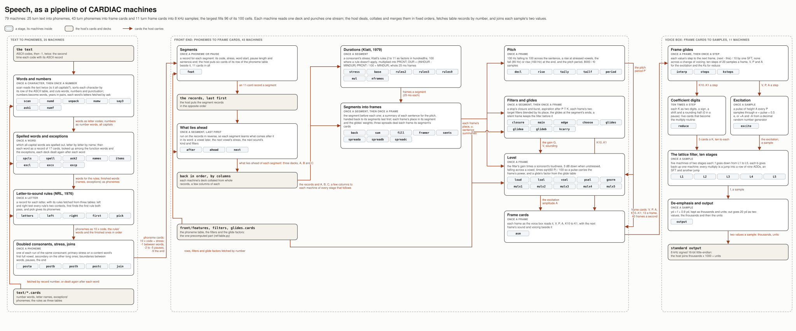

# cardiac-speech

cardiac-speech is text to speech that runs on CARDIACs. You give it a line of ASCII text and it gives you speech as
raw 8 kHz audio. Every step of the work, from finding the words in the text to the last sample of sound, is done by
63 CARDIAC programs running under [heartburn](https://github.com/StrangeQuery/heartburn), the CARDIAC engine. The
host program only moves cards between the machines: it deals the text and the decks the machines read, carries each
machine's output cards on to the machines that read them, and writes the samples out.

The diagram is drawn by [`docs/diagram.py`](docs/diagram.py), which reads the list of machines from the Rust code
that wires them together and stops if the picture and the code disagree.

## Running it

You need [Rust](https://rustup.rs). Cargo fetches heartburn from crates.io by itself.

    cargo build --release

That builds three programs in `target/release/`. The one you want is `talk`. It takes the text as its arguments, or
on standard input if there are none, and writes the samples to standard output:

    target/release/talk "Hello, my name is cardiac and I was born in 1968 to D W Hagelbarger. And now I can talk." \
        | ffplay -nodisp -autoexit -f s16le -ar 8000 -ch_layout mono -

The samples come out raw, with no header, so the player has to be told what they are. Each one is a signed 16-bit
little-endian number (`-f s16le`), there are 8,000 of them a second (`-ar 8000`), and there is one channel. To save
the speech as a WAV file instead:

    echo "Hello world." | target/release/talk | ffmpeg -f s16le -ar 8000 -ac 1 -i - hello.wav

`talk` has three options:

| | |
|---|---|
| `--phonemes` | print the phoneme cards the text machines make, one a line, instead of speaking |
| `--frames` | print the frame cards the front end makes, one a line, instead of speaking |
| `-v` | after speaking, print each machine's instruction count, the totals and the real-time factor on standard error |

The other two programs run parts of the pipeline on their own. `talk-phonemes` reads phoneme cards and prints frame
cards, and `talk-frames` reads frame cards and writes samples. They are there for testing.

On this Mac (an Apple M5 Ultra) the sentence above, 7.83 seconds of speech, takes 0.076 seconds to work out: a
real-time factor of 0.0097.

## The inspiration: the Speak & Spell

Texas Instruments' Speak & Spell came out in 1978. It was a spelling toy that spoke, and at its heart was the
TMC0281 (also sold as the TMS5100), a single chip that synthesized speech by linear predictive coding, or LPC
[[Santo 2019]](#references) [[ETHW]](#references). The IEEE made it a Milestone in 2009 as the first use of a
digital signal processing chip for speech generation. Its plaque credits Richard Wiggins, Paul Breedlove, Larry
Brantingham and Gene Frantz [[ETHW]](#references).

LPC stores speech as a model of the vocal tract instead of as a recording. A frame of LPC is a handful of numbers:
whether the sound is voiced, its pitch, its loudness, and the coefficients of a filter. The synthesizer feeds a buzz
(for voiced sounds) or a hiss (for unvoiced ones) through that filter, and a new frame arrives many times a second.
The chip's patent describes a filter driven by ten stored coefficients (its K-stack holds ten), voiced excitation
from a "chirp ROM", output samples at ten kilohertz, new frames 50 times a second with eight interpolation steps
inside each one, and a data rate "on the order of 1,000 to 1,200 bits per second" [[US 4,331,836]](#references).
The toy kept its words in a pair of 128-kilobit ROM chips [[Santo 2019]](#references). The patent describes the
design as it was filed, and none of the sources checked for this README gives the shipped toy's sample rate and
frame rate, so the figures here are the patent's.

The Speak & Spell's words were recorded. Richard Wiggins said in 2008 that the team chose one person, collected that
person's voice on tape, digitized hundreds of utterances, coded them by LPC, and then did "a substantial amount of
hand editing", for about 200 words [[Edwards 2008]](#references).

cardiac-speech borrows the Speak & Spell's back end: frames of LPC coefficients, a lattice filter with ten
coefficients, a voiced or unvoiced source, and interpolation between frames. Where it differs is the front end.
There is no recording anywhere in it. Every frame is worked out by rule from the text, using published tables of
how English is spelled, how long its sounds last, where their formants sit and how loud they are. So it can say any
text, not only a fixed vocabulary.

## How it works

The work is done in three parts, which the diagram shows from left to right.

### Text to phonemes: the NRL rules

Nineteen machines turn the text into phonemes. `scan` reads the text twice, first to see whether it is all
capitals, and then to sort each character into letters, digits and punctuation. Numbers become number words (years
from 1100 to 1999 are read in pairs, as "nineteen sixty eight"). All-capital words such as MTV are spelled out by
the names of their letters. A short list of function words and exceptions is looked up next, and everything else
goes to the letter-to-sound rules.

The rules are the Naval Research Laboratory's, from Elovitz, Johnson, McHugh and Shore's 1976 report
[[Elovitz 1976]](#references). Each rule says that a group of letters, between a left context and a right context,
is spoken as certain phonemes. The rules for a letter are tried in order, and the first one that matches wins. On
CARDIACs, `filter` reads through the rule deck to the section for the current letter, `rule` hands each rule's left
and right contexts to `ctxl` and `ctxr`, which test them by reading out from the letter in each direction through
the word, and the first rule both of them pass gives its phonemes. The rule deck is 5,680 cards, and the host deals
it to `filter` again each time it reaches the end. Three more machines collapse doubled consonants (the rules give
LITTLE two Ts), put primary stress on a content word's first full vowel and secondary stress on its other long
vowels, and mark the boundaries between words.

The rules were typed in from the report's Table 6, and the stress rules, the exception list and the handling of
numbers and spelling were added for this program. [`TTS_SOURCES.md`](../tools/lpc/TTS_SOURCES.md) in the prototype
lists which numbers come from which table and which are estimates.

### Phonemes to frames: Klatt's durations and formants

Thirty-four machines turn the phonemes into frame cards, one frame every 25 milliseconds. They run in three phases.
First `feat` makes an 11-card record for each sound. Then the host puts the records in the opposite order, and
`after`, `ahead` and `next` run through them last first, so that each sound can learn what comes after it in its
word. Finally the host puts everything back in order, and the remaining 30 machines work forward, a sound and then a
frame at a time.

The durations come from Dennis Klatt's 1979 rules [[Klatt 1979]](#references). Each sound has an inherent and a
minimum duration, and a percentage, PRCNT, starts at 100 and is multiplied by a factor for each rule that applies:
140 for the last syllable before a pause, 85 for a vowel that isn't in its word's last syllable, 80 in a word of
several syllables, and so on. Then the duration is

    DUR = (INHDUR - MINDUR) x PRCNT / 100 + MINDUR

The rules are lists of factors in hundredths, so `mul` can multiply them in with a few digits of decimal arithmetic.

The formant frequencies and bandwidths come from Klatt's 1980 paper on his cascade/parallel formant synthesizer
[[Klatt 1980]](#references): its Table II for the vowels, with their off-glides, and its Table III for the
consonants. The loudness of each sound comes from Sacia and Beck's 1926 measurements of the power of speech sounds
at Bell Labs [[Sacia and Beck 1926]](#references).

Each frame's filter is chosen by `choose`. A vowel moves from its target to its off-glide across the segment, a
stop has a silent closure and then a burst of noise, P, T and K breathe out over the first frame of the sound after
them, and the first and last frames of a sound glide halfway towards its neighbours. The pitch starts at 130 Hz and
falls to 100 Hz across each sentence (Klatt gives that fall for an isolated vowel [[Klatt 1980]](#references), and
here it is stretched over the sentence). A stressed vowel's onset is raised by 15 percent for primary stress and 7
for secondary, and from the last stressed vowel on the pitch moves towards 85 Hz for a statement or 160 Hz for a
question. The level stage scales each frame's gain by the sound's loudness and its stress, lets it fall across a
vowel, and multiplies a voiced frame by the square root of its pitch period, so that one pulse a period carries the
frame's power.

### Frames to samples: the lattice in three-digit arithmetic

Ten machines turn frame cards into samples. A frame is 13 cards: V (voiced or not), P (the pitch period in samples),
A (the excitation's amplitude) and the ten reflection coefficients K10 to K1, each times 1,000. `interp` works out
each value's step to the next frame, (next - this) / 10, which is one SFT, and `steps` hands out ten steps of 20
samples each, moving every value on by its step. There is no glide across a change between voiced and unvoiced.
`excite` makes the excitation: a pulse of height A every P samples, or +A and -A chosen by a
decimal random number generator, x = 21 x + 7 mod 1000.

The filter is the ten-stage LPC lattice. Each stage works out

    f = f - k b        b' = b + k f

with k between -1 and 1. Ten stages make twenty multiplications a sample, and a CARDIAC has no multiply
instruction. So each coefficient is cut down to two decimal digits and a sign, and multiplying by it is a jump into
a row of nine ADD instructions:

- `reduce` turns each K into five cards: a sign word (ADD t or SUB t), two jumps into the row of ADDs, one for each
  digit, an SFT, and a rounding half. K keeps two digits from its first nonzero one, so 0.734 is 0.73 and 0.052 is
  0.052, and a K that needs rounding is rounded.
- A lattice machine reads those cards straight into its multiply routine, so the routine is rewritten every step.
- To multiply x by k, it jumps into the row so that the first digit's number of ADDs run, shifts one place left,
  jumps in again for the second digit, adds half a unit away from zero, and shifts right to the result. The row
  runs on into cell 99, where the JMP into it left the way back.

A full lattice of ten stages doesn't fit in one machine's cells, so it is split over five machines of two stages
each. f passes down from `L1` to `L5`, and each machine sends its b back up to the one above for the next sample.

The output stage applies the de-emphasis, yd = f + 0.9 yd, and outputs 20 yd. A 16-bit sample doesn't fit in a
cell, so `output` keeps yd as thousands and units, works out 0.9 of the units as (9 L + 5) / 10, and outputs each
sample as two values, the thousands and then the units from 0 to 999. The host joins each pair back into a sample,
thousands x 1,000 + units.

### Where the integer version differs from the prototype

The rules were first built as a floating-point program in Python (`tools/lpc/phonemes_to_frames.py`), and the CARDIAC
version follows it rule by rule. Where the float version needs a cosine, an exponential, a square root or a
division, the CARDIAC version does a decimal thing instead. [`ref/front_ref.py`](ref/front_ref.py) is the integer
version in Python, and each such place is marked INTEGER there. The differences you can hear are these:

- **Glides.** The float front end glides the formant frequencies between sounds and works out new filter
  coefficients for every frame. The CARDIACs blend the reflection coefficients of the two targets instead,
  (x (10 - u) + y u) / 10, with u the frame's place in its sound in tenths (`glidea`, `glideb`).
- **Vowel decay.** The float front end lets a vowel's power fall 3 dB from start to end on a decibel scale. The
  CARDIACs take a straight line off the amplitude, 30 u / 1000 (`vsel`).
- **Square root.** The float synthesizer scales a pulse by the square root of the pitch period. The CARDIACs use
  isqrt(60 P) / 100, found by counting the odd numbers 1, 3, 5 and so on that can be taken away (`psel`), and the
  phoneme table scales the unvoiced filters by sqrt(60) / 100 to keep the balance between voiced and unvoiced.
- **Pulses, not a chirp.** The Python pipeline excites voiced frames with a short chirp, as the Speak & Spell did.
  The CARDIACs use a single pulse a period.
- **Pitch.** The fall across a sentence and the place in the final fall are kept by Bresenham's method, adding and
  taking away instead of dividing (`decl`, `taily`), and the pitch period is 8000 / f0 by repeated subtraction
  (`period`).

`ref/compare_wavs.py` sets the CARDIAC speech beside the Python pipeline's (the float front end, then the
CARDIAC-arithmetic synthesizer with the chirp), sound by sound. For the sentence above, the log-spectral distance
between the two is 8.9 dB and the sounds' levels differ by 1.5 dB on average. For "the quick brown fox jumps over
the lazy dog" the figures are 7.3 dB and 1.3 dB.

## What each machine does

These are all 63 machines, in the order the host wires them. Cells are the cells each listing fills. A CARDIAC has
100 cells; cell 00 always holds 001 and the loader uses cells 01 and 02, so a program has cells 03 to 99, and a
program that JMPs uses cell 99 for the way back. Instructions are counted by `talk -v` for "Hello, my name is cardiac
and I was born in 1968 to D W Hagelbarger. And now I can talk.", which comes to 101 phoneme cards, 313 frames and
62,600 samples (7.83 seconds), and they include each machine's loading of its own deck. For the voice box, the last
column also gives the count per sample.

### Text to phonemes (19 machines)

| Machine | Listing | What it does | Cells | Instructions |
|---|---|---|---:|---:|
| scan | [text/scan.cq](text/scan.cq) | reads the text twice, sees whether it has a small letter, and cuts it into words, numbers and punctuation by each character's row of the ASCII table | 95 | 3,180 |
| numd | [text/numd.cq](text/numd.cq) | drops a number's leading zeros and keeps its last six digits | 91 | 1,598 |
| numw | [text/numw.cq](text/numw.cq) | splits a number into groups of three digits and the words between them, reading years from 1100 to 1999 in pairs | 90 | 1,158 |
| say3 | [text/say3.cq](text/say3.cq) | says a group of three digits as number words | 50 | 1,047 |
| numf | [text/numf.cq](text/numf.cq) | spells each number word by fetching it from the numbers deck | 30 | 1,083 |
| spcls | [text/spcls.cq](text/spcls.cq) | decides which all-capital words are spelled out letter by letter | 85 | 2,247 |
| spell | [text/spell.cq](text/spell.cq) | makes a spelled word ready for `names`, marking its last letter | 75 | 2,611 |
| names | [text/names.cq](text/names.cq) | says each letter by name, fetching the name's phonemes and stressing the last letter | 82 | 1,694 |
| excl | [text/excl.cq](text/excl.cq) | looks each word up among the function words and the exceptions, reading the word deck through for each word | 96 | 176,254 |
| excp | [text/excp.cq](text/excp.cq) | replaces an exception with its phonemes from the exceptions' deck | 76 | 2,725 |
| loader | [text/loader.cq](text/loader.cq) | holds a word for the rules, asks for each letter's rules, and moves on by the length of the rule that matched | 77 | 4,339 |
| filter | [text/filter.cq](text/filter.cq) | reads through the rule deck to the current letter's section and passes its rules on | 30 | 473,370 |
| rule | [text/rule.cq](text/rule.cq) | sends each rule's left and right contexts to the context machines and gives the phonemes of the first rule both pass | 59 | 76,707 |
| ctxl | [text/ctx.cq](text/ctx.cq) | tests a rule's left context, reading leftwards through the word | 82 | 17,012 |
| ctxr | [text/ctx.cq](text/ctx.cq) | tests a rule's right context, reading rightwards through the word | 82 | 44,058 |
| posta | [text/posta.cq](text/posta.cq) | keeps one of each run of the same consonant | 24 | 1,118 |
| postb | [text/postb.cq](text/postb.cq) | gathers a rules word and notes whether it is a function word and whether it has a full vowel | 74 | 2,370 |
| postc | [text/postc.cq](text/postc.cq) | gives each phoneme of a rules word its stress | 93 | 2,225 |
| join | [text/join.cq](text/join.cq) | puts the boundaries between words, the pauses and the end card in place for the front end | 85 | 2,000 |
| | | **19 machines** | | **816,796** |

### Front end (34 machines)

| Machine | Listing | What it does | Cells | Instructions |
|---|---|---|---:|---:|
| feat | [front/feat.cq](front/feat.cq) | makes an 11-card record for each sound and pause, with six cards of the sound's row of the phoneme table | 93 | 6,508 |
| after | [front/after.cq](front/after.cq) | last first: whether a vowel comes later in the word, and the stress of the next vowel | 38 | 1,773 |
| ahead | [front/ahead.cq](front/ahead.cq) | last first: the kind of the next sound, whether the word comes before a pause, and a vowel's Klatt rule 9 factor | 93 | 3,304 |
| next | [front/next.cq](front/next.cq) | last first: the next sound that isn't a pause, the next vowel, and each sound's start and end filters | 76 | 3,045 |
| stress | [front/stress.cq](front/stress.cq) | a consonant's stress, and whether a sound is in its word's last syllable or before a pause | 88 | 4,090 |
| base | [front/base.cq](front/base.cq) | the inherent and minimum durations, halving the minimum for an unstressed sound (rules 7 and 11) | 61 | 2,740 |
| rules2 | [front/rules2.cq](front/rules2.cq) | Klatt's duration rules 2 to 7, as a list of factors in hundredths | 93 | 3,209 |
| rules9 | [front/rules9.cq](front/rules9.cq) | Klatt's duration rules 9 and 10, as a list of factors | 77 | 2,830 |
| mul | [front/mul.cq](front/mul.cq) | multiplies the factors into PRCNT and works out the duration in milliseconds | 81 | 16,245 |
| nframes | [front/nframes.cq](front/nframes.cq) | turns durations into whole 25 ms frames, carrying the remainder on | 64 | 5,527 |
| back | [front/back.cq](front/back.cq) | the sound before each one: its end filter, whether it is a vowel, whether it is P, T or K | 41 | 2,224 |
| sum | [front/sum.cq](front/sum.cq) | one summary a sentence for the pitch: its length in frames and where the final fall starts | 89 | 2,470 |
| framer | [front/framer.cq](front/framer.cq) | each frame's place in its sound in tenths, and the weights of the glides at the sound's ends | 94 | 30,825 |
| closure | [front/closure.cq](front/closure.cq) | how many of a stop's or affricate's frames are its closure | 79 | 1,472 |
| main | [front/main.cq](front/main.cq) | the filters a sound's frames speak through, and whether they are voiced | 90 | 3,375 |
| edge | [front/edge.cq](front/edge.cq) | a voiced stop's voice bar, and the breathy first frame after P, T or K | 63 | 2,064 |
| choose | [front/choose.cq](front/choose.cq) | each frame's two target filters, and whether it sounds and is voiced | 92 | 13,049 |
| glides | [front/glides.cq](front/glides.cq) | at a sound's first and last frames, the filters to glide from and how far | 64 | 10,544 |
| glidea | [front/glidea.cq](front/glidea.cq) | fetches the two target filters and blends them by the frame's place | 67 | 95,672 |
| glideb | [front/glideb.cq](front/glideb.cq) | blends the frame's filter towards halfway to its neighbour's at the sound's ends | 77 | 130,132 |
| decl | [front/decl.cq](front/decl.cq) | the pitch falling from 130 Hz to 100 Hz across the sentence | 59 | 8,424 |
| rise | [front/rise.cq](front/rise.cq) | the rise at a stressed vowel, 15 or 7 percent, fading across the vowel | 89 | 10,543 |
| taily | [front/taily.cq](front/taily.cq) | how far each frame is into the sentence's final fall, in hundredths | 76 | 10,369 |
| tailf | [front/tailf.cq](front/tailf.cq) | the final fall to 85 Hz or rise to 160 Hz | 75 | 7,564 |
| period | [front/period.cq](front/period.cq) | the pitch period, 8000 / f0 samples rounded, by repeated subtraction | 44 | 296,163 |
| lsel | [front/lsel.cq](front/lsel.cq) | for a sonorant, the loudness of the vowel next to it | 66 | 7,442 |
| vsel | [front/vsel.cq](front/vsel.cq) | for a vowel, 3 dB down when unstressed and the fall across the vowel | 57 | 9,635 |
| psel | [front/psel.cq](front/psel.cq) | for a voiced frame, sqrt(60 P) / 100 by counting odd numbers | 73 | 200,726 |
| mulx1 | [front/mulx.cq](front/mulx.cq) | multiplies the gain by `lsel`'s factor | 72 | 5,360 |
| mulx2 | [front/mulx.cq](front/mulx.cq) | multiplies by `vsel`'s stress factor | 72 | 6,987 |
| mulx3 | [front/mulx.cq](front/mulx.cq) | takes off `vsel`'s fall across the vowel | 72 | 10,566 |
| mulx4 | [front/mulx.cq](front/mulx.cq) | multiplies by `psel`'s square root | 72 | 12,760 |
| kcarry | [front/kcarry.cq](front/kcarry.cq) | gives a silent frame the filter of the frame before it | 41 | 32,118 |
| asm | [front/asm.cq](front/asm.cq) | puts each frame together as the voice box reads it, V, P, A, K10 to K1, and ends with -1 | 80 | 33,700 |
| | | **34 machines** | | **993,455** |

### Voice box (10 machines)

| Machine | Listing | What it does | Cells | Instructions | Per sample |
|---|---|---|---:|---:|---:|
| interp | [voice/interp.cq](voice/interp.cq) | each value's step to the next frame, none across a change of voicing | 63 | 57,167 | 0.9 |
| steps | [voice/steps.cq](voice/steps.cq) | ten steps of 20 samples a frame, each value moved on by its step | 62 | 540,743 | 8.6 |
| reduce | [voice/reduce.cq](voice/reduce.cq) | each K as the five cards of a multiply routine | 82 | 1,214,703 | 19.4 |
| excite | [voice/excite.cq](voice/excite.cq) | pulses every P samples, or random plus and minus A | 52 | 1,010,624 | 16.1 |
| L1 | [voice/lattice_top.cq](voice/lattice_top.cq) | lattice stages 10 and 9 | 89 | 6,280,279 | 100.3 |
| L2 | [voice/lattice.cq](voice/lattice.cq) | lattice stages 8 and 7 | 93 | 7,509,943 | 120.0 |
| L3 | [voice/lattice.cq](voice/lattice.cq) | lattice stages 6 and 5 | 93 | 7,578,417 | 121.1 |
| L4 | [voice/lattice.cq](voice/lattice.cq) | lattice stages 4 and 3 | 93 | 7,727,315 | 123.4 |
| L5 | [voice/lattice_bottom.cq](voice/lattice_bottom.cq) | lattice stages 2 and 1 | 94 | 8,291,816 | 132.5 |
| output | [voice/output.cq](voice/output.cq) | the de-emphasis, and each sample as thousands and units | 48 | 2,412,615 | 38.5 |
| | | **10 machines** | | **42,623,622** | **680.9** |

All together the 63 machines ran 44,433,873 instructions for 7.83 seconds of speech, which is about 5.7 million
instructions a second of speech, or 710 a sample. The voice box does 96 percent of that work, and the five lattice
machines alone do 84 percent. The text machines and the front end run 1.8 million instructions between them, and
most of those go to reading through decks (`filter`, `excl`) and to the division and square root done by
subtraction (`period`, `psel`). The largest listings, `excl` at 96 cells and `L5` at 94, are close to the 97 a
program can have.

[`text/exc.cq`](text/exc.cq) is in the repo but no machine runs it. It is the first version of the lookup that
`excl` and `excp` now do between them.

## Comparison with other speech generators

| | Year | Method | Stored data | Rate |
|---|---|---|---|---|
| Texas Instruments TMC0281 / TMS5100 (Speak & Spell) | 1978 [[Santo 2019]](#references) | LPC with ten filter coefficients, chirp excitation [[US 4,331,836]](#references) | words analysed from recordings of one speaker, hand edited, about 200 words [[Edwards 2008]](#references) | 10 kHz samples, 50 frames a second, 1,000 to 1,200 bits a second in the patent [[US 4,331,836]](#references) |
| General Instrument SP0256-AL2 | datasheet dated 1984 [[SP0256-AL2 datasheet]](#references); first year not found | LPC through a 12-pole digital filter, sounds strung together by a host processor | allophones and five pauses, 64 sounds in all, in a 16K internal ROM | output 0 to 5 kHz from a 3.12 MHz clock; sample rate and data rate not stated in the datasheet |
| Votrax SC-01 | priority date 1980 [[US 4,433,210]](#references) | phonemes through four analog resonant filters (F1, F2, F3 and F5) built from switched capacitors | 64 phonemes of 12 four-bit parameters each | an 8-bit command word a phoneme, with two of its bits for inflection; phonemes last about 50 to 250 ms |
| SAM, Software Automatic Mouth | 1982 [[Brannon and Halfhill 1982]](#references) | software only; its Reciter turns English text into phonemes by rule; the sound is two sine waves and a square wave at three formant-like frequencies, summed [[Macke, SAM]](#references) | phoneme input, about 50 or 60 phonemes | sample rate not found |
| DECtalk (Klatt's synthesizer) | about 1984 [[CHM DECtalk]](#references) | rules to a digital formant synthesizer, created by Dennis Klatt [[Hallahan 1995]](#references); Klatt's own cascade/parallel synthesizer is described in [[Klatt 1980]](#references) | letter-to-sound rules and a dictionary | DECtalk PC 10 kHz [[Hallahan 1995]](#references); Klatt's 1980 synthesizer 10,000 samples a second, its parameters updated every 5 ms [[Klatt 1980]](#references) |
| cardiac-speech | 2026 | NRL letter-to-sound rules, Klatt's durations and formants turned into LPC reflection coefficients, a ten-stage lattice in decimal arithmetic | the rule and word decks, and a table of 41 phonemes' features and their filters | 8 kHz samples, 40 frames a second, 520 frame cards a second into the voice box (13 a frame) |

cardiac-speech sits between the two families. Its back end is the Speak & Spell's kind of machine, an LPC lattice
fed frame by frame, but its frames come from rules, as DECtalk's do, rather than from analysed recordings. Its
synthesizer is not Klatt's formant synthesizer, though. Klatt's formants are turned into reflection coefficients
once, ahead of time, and the CARDIACs only blend those. The Votrax and the SP0256 string stored sounds together, and
cardiac-speech instead works out every frame of every sound from its neighbours.

The cost on a CARDIAC is large. One second of speech takes about 5.7 million CARDIAC instructions over 63 machines,
and at 8,000 samples a second that is 710 instructions a sample. Under heartburn on this Mac, the 63 machines take
turns on one thread, and the sentence takes 0.076 seconds, a real-time factor of 0.0097.

## Reliance on lubdub

cardiac-speech doesn't use any of lubdub's code. Its only dependency, in `Cargo.toml` and `Cargo.lock`, is
heartburn 0.1, the CARDIAC engine that lubdub also depends on. What it takes from lubdub is two ideas from
[lubdub's docs/AUDIO.md](../lubdub/docs/AUDIO.md), and the way samples leave the machine:

- **Multiplying by jumping into a row of ADDs.** lubdub's decoder multiplies a code by a step size M x 10^K by
  jumping into a row of nine `ADD c` instructions so that M of them run, and then shifting K places with one SFT.
  cardiac-speech's lattice machines do the same thing twice over: a coefficient is two decimal digits, so a
  multiply is a jump into the row for the first digit, an SFT, a jump for the second digit, and a final SFT.
  `reduce` makes those jumps and shifts as cards, as lubdub's block header writes its jump and its SFTs into the
  decoder. `mul`, `mulx`, `rise`, `tailf` and `glidea` use rows of ADDs the same way.
- **A sample as two values.** lubdub's decoder keeps each sample as thousands and units and outputs the thousands
  and then the units, and its player joins them. `output.cq` does the same, and like lubdub it sums the units on top
  of 2000 so they never go negative, so that STO keeps the new units and SFT 03 gives the carry. `voice::sample` joins
  the pair in the host as lubdub's player does.

lubdub's encoder chooses each code by what the decoder will really produce, and the LPC prototype tried the same
closed-loop choice for frame cards (`tools/lpc/closedloop.py`). cardiac-speech does not use it. Its frame cards come
straight from the rules, and `ref/compare_wavs.py` only uses the closed-loop pipeline as something to compare
against.

## What the host does and doesn't do

The host, [`src/net.rs`](src/net.rs), keeps piles of cards. A machine waiting at an INP is given the next card from
the pile wired to that INP's cell, and each value a machine outputs goes onto the pile wired to that OUT's cell. On
top of that the host can:

- **deal** a pile's cards a few at a time to several piles in turn, as it deals each lattice machine its ten
  coefficient cards a step;
- **copy** every card put on a pile onto several piles, when several machines read the same deck;
- **collate** whole records from several piles into one, picking some cards (columns) of each, as a collator merges
  decks;
- **fetch** a record of a table deck when a machine outputs its record number, as a librarian fetches a book by its
  call number;
- **cycle** a deck, dealing it again whenever a machine waits on it empty, as the rule deck is read through again
  for every letter.

Between the phases of the front end, the host puts the segment records in the opposite order and then back again.
It turns the text into cards, one ASCII code a character (anything that isn't ASCII becomes a space), and it joins
each pair of output values into a 16-bit sample. It never looks at what a card says, except that a fetch uses a card
as a record number.

The host does no arithmetic on the speech. Durations, frames, pitch, filters, glides, levels, interpolation,
excitation, the filter itself and the output are all worked out by the CARDIACs.

## What's precomputed

One thing is worked out ahead of time: the phoneme table, [`front/features.cards`](front/features.cards) and
[`front/filters.cards`](front/filters.cards), made by [`ref/table.py`](ref/table.py). Turning Klatt's formant
frequencies and bandwidths into reflection coefficients needs cosines and exponentials (each formant becomes a pair
of poles, r = exp(-pi B T) at angle 2 pi F T), a step-down recursion that divides, and square roots for the gains.
None of that is something a CARDIAC could do in a reasonable number of cells, and none of it depends on the text,
so it is done once, in floating point, and stored as cards, the way the Speak & Spell kept its words in ROM. The
table has a record of 17 cards for each of the 41 phonemes, and 11 cards (K10 to K1 and a gain) for each filter.

The other decks are not computations. [`text/`](text/) holds the ASCII table, the number words, the letters'
names, the function words and exceptions and their phonemes, and the NRL rules, all as cards transcribed from the
prototype's tables.

## How it was checked

Every machine was written against a Python reference that does exactly the same integer arithmetic, and is checked
against it card for card. The references are in [`ref/`](ref/): `text_ref.py` for the text machines,
`front_ref.py` for the front end and `voice_ref.py` for the voice box. The references are in turn checked against
the prototype, `tools/lpc/text_to_phonemes.py` and the prototype's decimal synthesizer.

These checks run the real programs under heartburn, and need a release build first:

    cargo build --release
    cd ref
    python3 check_text.py                    # talk --phonemes on 912 texts against text_to_phonemes.py
    python3 check_front.py                   # talk-phonemes and talk-frames on 23 sentences against front_ref and voice_ref
    python3 check_voice.py hello cardiac fox # talk-frames on the prototype's frame files against voice_ref

On the day this README was written, check_text found all 912 texts exact, check_front found the frame cards and
the samples exact for all 23 sentences, and check_voice found all three exact. `make_wavs.py` runs `talk` on three
texts, writes WAVs into `tools/lpc/out/` and checks every sample against the three references end to end, and
`compare_wavs.py` compares the speech with the Python pipeline's. The frame files check_voice reads were made by
the prototype's LPC encoder, `tools/lpc/encode.py`, from WAV files; they are test input for the voice box only.

There are also tests of single machines on `ref/cardiac.py`, a CARDIAC written in Python for trying programs
quickly. `run_tests.py f1 f2a f2b f2c stress base rules2 rules9 mul nframes back sum framer closure main edge choose
glides glidea glideb level asm pitch` tests each front-end machine on 23 sentences, `test_text_m.py scan numd numw
say3 numf spcls spell names excl excp match posta postb postc join` tests each text machine on the 912 texts,
`test_lattice.py` tests the five lattice machines with awkward coefficients, and `test_voice.py` and
`test_front_net.py` run the voice box and the whole front end. All of them reported exact. These need `carc` from a
heartburn checkout at `~/projects/heartburn/target/release/carc`, and the prototype in `~/projects/tools/lpc`.

## Known limits

- **Words of at most 13 letters.** `loader` and the two context machines hold the word in cells 85 to 97, with an
  edge after it in 98. A longer word overruns, and its phonemes come out wrong. "extraordinary" (13 letters) is
  right, and "Constantinople" (14) gets an extra phoneme at the end.
- **A fixed level and no clipping.** The scale is set once in the phoneme table (C = 36 in `ref/table.py`), chosen
  so that the loudest test sentences stay well inside a cell in the lattice. The loudest of the 23 test sentences
  reaches |yd| = 610, about 12,200 in the output. Nothing in the voice box clips: a louder text would wrap, because
  STO keeps only the last three digits.
- **Pulses, not a chirp.** The voice is excited by a single pulse a period, which sounds buzzier than the Speak &
  Spell's chirp.
- **Doubled consonants are collapsed in the stream.** `posta` drops a consonant that repeats the card before it,
  wherever it comes, while the prototype does this only to the rules' words. The two agree because no exception's
  phonemes and no letter's name has a doubled consonant. An exception added with one would come out differently
  from the prototype.
- **The pauses are chosen, not sourced.** A comma pauses 300 ms and the end of a sentence 600 ms. Klatt's rule gives
  200 ms at a comma and none at a sentence end [[Klatt 1979]](#references).

## References

- C. Brannon and T. R. Halfhill, "Speech Synthesizers For Atari And Apple", COMPUTE! 30, November 1982, p. 107. https://atarimagazines.com/compute/issue30/098_1_Review_Speech_Synthesizers_For_Atari_And_Apple.php. SAM's maker, year, prices, that it is software only, its Reciter and its phonemes.
- Computer History Museum, "DECtalk speech synthesizer", catalog 102757099, made circa 1984. https://www.computerhistory.org/collections/catalog/102757099. DECtalk's year.
- B. Edwards, "VC&G Interview: 30 Years Later, Richard Wiggins Talks Speak & Spell Development", Vintage Computing and Gaming, 2008. https://www.vintagecomputing.com/?p=528. How the Speak & Spell's words were recorded, analysed and edited, and how many there were.
- H. S. Elovitz, R. W. Johnson, A. McHugh and J. E. Shore, "Automatic Translation of English Text to Phonetics by Means of Letter-to-Sound Rules", NRL Report 7948, Naval Research Laboratory, 1976. https://archive.org/details/DTIC_ADA021929. The letter-to-sound rules.
- ETHW, "Milestones: Speak & Spell, the First Use of a Digital Signal Processing IC for Speech Generation, 1978", IEEE Milestone dedicated 2009. https://ethw.org/Milestones:Speak_&_Spell,_the_First_Use_of_a_Digital_Signal_Processing_IC_for_Speech_Generation,_1978. The Milestone, the TMS5100 and the people it credits.
- General Instrument, "SP0256 Narrator Speech Processor" (Radio Shack 276-1784 technical data), 1984. https://bitsavers.mirrorservice.org/components/gi/speech/General_Instrument_-_SP0256A-AL2_datasheet_(Radio_Shack_276-1784)_-_Apr1984.pdf, also at https://people.ece.cornell.edu/land/courses/ece4760/Speech/SPO256-AL2.pdf. The SP0256's 12-pole filter, its allophones and pauses, its ROM, clock and output band.
- W. I. Hallahan, "DECtalk Software: Text-to-Speech Technology and Implementation", Digital Technical Journal 7(4), 1995. https://www.zx.net.nz/mirror/digital/DTJ/www.hpl.hp.com/hpjournal/dtj/vol7num4/vol7num4art1.pdf. DECtalk's formant synthesizer, its sample rates, and Klatt as the synthesizer's creator.
- B. Santo, "The Consumer Electronics Hall of Fame: Texas Instruments' Speak & Spell", IEEE Spectrum, 31 October 2019. https://spectrum.ieee.org/the-consumer-electronics-hall-of-fame-texas-instruments-speak-spell. The Speak & Spell's year, the TMC0281, LPC, and its two 128-kilobit ROMs.
- D. H. Klatt, "Synthesis by rule of segmental durations in English sentences", Proceedings of the 9th International Congress of Phonetic Sciences, Copenhagen, 1979, pp. 290-297. https://www.coli.uni-saarland.de/Phonetics/icphs/ICPhS1979/p9.2_290.pdf. The duration model, the inherent and minimum durations, and the duration rules.
- D. H. Klatt, "Software for a cascade/parallel formant synthesizer", Journal of the Acoustical Society of America 67(3), 971-995, 1980. https://www.fon.hum.uva.nl/david/ba_shs/2009/klatt-1980.pdf. The formant targets and bandwidths, the resonator, the 130 to 100 Hz fall, and the synthesizer's 10,000 samples a second and 5 ms updates.
- S. Macke, "SAM: Software Automatic Mouth", a C port reverse engineered from the 1982 program. https://github.com/s-macke/SAM. How SAM makes its sound.
- C. F. Sacia and C. J. Beck, "The Power of Fundamental Speech Sounds", Bell System Technical Journal 5(3), 393-403, 1926. https://archive.org/details/bstj5-3-393. The power of each speech sound.
- C. L. Ostrowski and B. White, "Integrated circuit phoneme-based speech synthesizer", US patent 4,433,210, Federal Screw Works, 1984 (priority 1980). https://patents.google.com/patent/US4433210A/en. The Votrax SC-01's resonant filters, its 64 phonemes and their parameters, its inflection bits and phoneme durations.
- R. H. Wiggins and G. L. Brantingham, "Speech synthesis integrated circuit device", US patent 4,331,836, Texas Instruments, 1982 (priority 1977). https://patents.google.com/patent/US4331836A/en. The Speak & Spell chip's coefficients, chirp excitation, sample rate, frame rate, interpolation and bit rate.
