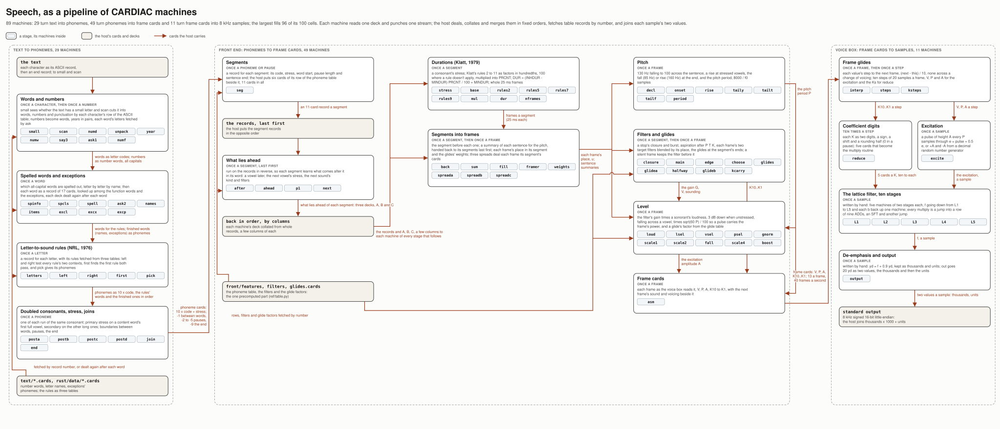

# cardiac-speech in Rust

This folder is the second version of cardiac-speech. It does the same work as the first, in the folder above, and
gives the same speech sample for sample, but its machines are written in Rust and compiled for CARDIAC with
[rust-cardiac](https://github.com/StrangeQuery/rust-cardiac), and each machine has one card reader and one punch,
as a real CARDIAC has. 89 machines do the work: 83 of them are Rust, and 6, the lattice filter and the output stage
of the voice box, are written by hand in CARDIAC's assembly language, because in Rust they are slower.

The diagram is drawn by [`docs/diagram.py --rust`](../docs/diagram.py), which reads the list of machines from
the Rust code that wires them together.

## Running it

You need [Rust](https://rustup.rs). The machines' decks are kept in the repository, so building the host needs
nothing else:

    cd rust
    cargo build --release
    target/release/talk "Hello, my name is cardiac and I was born in 1968 to D W Hagelbarger. And now I can talk." \
        | ffplay -nodisp -autoexit -f s16le -ar 8000 -ch_layout mono -

`talk`, `talk-phonemes` and `talk-frames` take the same options as the first version's, `--phonemes`, `--frames`
and `-v`. `talk` and `talk-frames` also take `--all-rust`, which runs the voice box with Rust machines in place of
the six hand-written ones, to compare (see below).

To change a machine, you need [cargo-cardiac](https://crates.io/crates/cargo-cardiac) as well (`cargo install
cargo-cardiac`, then `cargo cardiac setup`). [`build_machines.sh`](build_machines.sh) compiles every machine in
[`machines/`](machines/) to its deck, next to its source (`machines/front/seg.rs` becomes `machines/front/seg.cqb`),
and writes their sizes to [`machines/cells.txt`](machines/cells.txt). The machines are one Cargo package, each a
binary target, built with overflow checks off. Each one uses the `cardiac` crate's `inp()` to read the next card
and `out(v)` to punch one, and nothing else of the outside world.

On this Mac (an Apple M5 Ultra) the sentence above, 7.83 seconds of speech, takes 0.078 seconds to work out, a
real-time factor of about 0.010, about the same as the first version's.

## How the host feeds the machines

Each machine reads one deck, a card at a time, and everything it punches goes onto one pile. The host never looks at
a machine's program counter or its cells, nor at which instruction punched a card. All it does is bookkeeping, and
none of it depends on what a card says, except a fetch, which uses a card as a record number, as a librarian uses a
call number:

- **deal**: a pile's cards go a few at a time to several piles in turn. reduce's cards are dealt ten at a time to
  the five lattice machines, two coefficients each a step, and each lattice machine's two cards a sample (its b for
  the machine above, then its f for the machine below) are dealt one to each.
- **copy**: every card put on a pile goes onto several piles, when several machines read the same cards.
- **collate**: whole records are taken from several piles, some cards (columns) of each, and put together onto
  one, as a collator merges decks. Most of the front end's decks are made this way, a record a segment or a record
  a frame.
- **merge**: several piles go into one in a fixed order, so many cards from this one and so many from that one,
  over and over, each waiting its turn until it has its cards. A deck can be one of them, dealt again each time its
  turn comes.
- **fetch**: a card names a record of a table (the phoneme table, the filters, the glide factors, the rule tables,
  the number words, the letters' names, the exceptions' phonemes, the ASCII table), and the host puts that record
  onto a pile.
- **re-deal**: between the front end's phases the host puts a deck of records in the opposite order and back.

Where a machine needs cards from more than one machine, its deck is merged in a fixed order:

| Machine | Its deck, in order |
|---|---|
| L1 | ten coefficient cards, then 20 times one excitation value and one b from L2 |
| L2, L3, L4 | ten coefficient cards, then 20 times one f from the machine above and one b from the machine below |
| L5 | ten coefficient cards, then 20 f from L4 |
| interp | the frames and the frames again from the second one on, a card from each in turn, so that each card of a frame comes beside the same card of the next frame; twelve blank cards follow the frames' end card, to make it a whole record |
| excl, excx | each word's record of 17 cards, then the whole deck of function words (excl) or exceptions (excx) |
| left, right | each letter's record (its place and the word), then the letter's record of the left or right rule table |
| first | left's and right's verdicts on each rule, one from each in turn |
| pick | each letter's record, then first's rule, then the letter's record of the phonemes table |
| glidea | the frame's tenths, then the two target filters' records a card from each in turn |
| halfway, glideb | the two filters' cards a card from each in turn (halfway), then the frame's weight and halfway's and glidea's cards in turn (glideb) |
| gnorm | the frame's filter and weight, then the glide table's record for it |
| asm | the frame's level, its period, its filter, and then the next frame's sound and voicing (choose's cards dealt again from the second frame on) |
| spinfo | small's one card, then all of numf's |
| numf, names | each card, then the table record its ask machine asked for |
| next, loud | first a card of AX's row of the phoneme table, then their records |

Where a machine used to keep cards on a pile of its own, it now keeps them in an array. Where a machine read some
cards only sometimes (a factor for each duration rule that applies, a table record only for some cards), it now
reads the same number every time: each duration rule gives a factor, 100 where it doesn't apply, and multiplying by
100 leaves PRCNT exactly as it is; every card gets a record from the numbers deck or the letters deck, and the
machine passes over the ones it doesn't need; every frame gets a record of the glide table. Only the order of the
cards changed, never the arithmetic, so the Python references in [`../ref/`](../ref/) check this version as they
check the first.

The two versions read the same decks, in [`../front/`](../front/) and [`../text/`](../text/). Among them,
`ref/text_tables.py` lays the NRL rules out again as three tables of one record a letter
([`rules_left.cards`](../text/rules_left.cards), [`rules_right.cards`](../text/rules_right.cards) and
[`rules_phonemes.cards`](../text/rules_phonemes.cards)), and splits the exceptions deck into
[`function.cards`](../text/function.cards) and [`exception_words.cards`](../text/exception_words.cards). Nothing in
them is computed: they are the same rules and words, in the same order.

## The machines written by hand, and why

The rule was to start with every machine in Rust, measure each one against the first version's (as it was then,
before it was given one reader and one punch too), and write by hand only the few where performance needs it. Two places need it.

**The lattice.** A lattice multiply is a coefficient of two digits times a value of up to three, and a digit times a
value can pass what a card holds. The hand-written machines keep the product in the accumulator's fourth digit and
multiply by jumping into a row of nine ADD instructions that reduce's cards rewrite every step, one instruction an
add. Rust can't write that row. Written as a loop that adds the value d times for a digit d, each add is a counter,
a test and a jump as well, and each multiply took three machines to fit in memory: a ten-stage lattice was 57
machines, which on the 8-second test sentence (`ref/fixtures/born1968_tts.frames`) ran 240,995,502 instructions,
3,766 a sample, where the five hand-written machines ran 35,287,701, 551 a sample.

So the Rust lattice multiplies by table instead. Once a coefficient, [ktable](machines/voice/ktable.rs) makes a
table of n times 0 to 9, n being its two digits as a number, and each multiply looks up the value's three digits in it and adds them a
place apart, so that the sum that passes a card is all in one expression and stays in the accumulator. A multiply
fits in one machine, [ksub](machines/voice/ksub.rs) for f = f - k b and [kadd](machines/voice/kadd.rs) for b' = b +
k f (both [kmul.rs](machines/voice/kmul.rs)), so the lattice is 20 machines. `talk-frames --all-rust` runs it, and
it gives the same samples: 64,233,593 instructions on the test sentence, 1,004 a sample, 1.8 times the hand-written
lattice. The other ways of writing it in Rust were no better: a `match` on the digit with an arm for each number of
adds is a chain of tests and too big to fit, and a row of adds written with labelled blocks stores the sum after
every add, which cuts it to a card (rust-cardiac issues 33 to 36). So the lattice stays as the first version has it,
[`hand/lattice_top.cq`](hand/lattice_top.cq), [`hand/lattice.cq`](hand/lattice.cq) and
[`hand/lattice_bottom.cq`](hand/lattice_bottom.cq), unchanged: their INPs and OUTs already come in a fixed order, a
sample at a time.

**The output stage.** yd reaches about 1,640, past a card, which the hand-written output stage keeps as thousands
and units in the accumulator. In Rust it takes two machines, deemph (the de-emphasis, with yd as tens and units) and
sample (20 yd as thousands and units), which on the README's sentence ran 5,355,363 instructions, 85.5 a sample,
against 2,631,841, 42.0 a sample, for the hand-written [`hand/output.cq`](hand/output.cq). That is 6 percent of the
whole, so the output stage is written by hand too. `--all-rust` runs deemph and sample.

Every other Rust machine is within a small factor of the hand-written one it replaces. The text machines ran
935,136 instructions against 875,205 then (860,492 now), the front end 2,260,389 against 1,427,517 then (2,209,801
now), and the voice box's five Rust machines (interp, steps, ksteps, reduce, excite) 4,598,314 against 3,527,705
then for the first version's four (3,414,657 now for its five).

## What each machine does

These are all 89 machines, in the order the host wires them. Cells are what `cargo cardiac build` reports for a
Rust machine (machines/cells.txt), and the cells a listing fills for a hand-written one; a program has cells 03 to
98. Instructions are counted by `talk -v` for "Hello, my name is cardiac and I was born in 1968 to D W
Hagelbarger. And now I can talk.", 62,600 samples (7.83 seconds), and include each machine's loading of its deck.

### Text to phonemes (29 machines)

| Machine | Source | What it does | Cells | Instructions |
|---|---|---|---:|---:|
| small | [machines/text/small.rs](machines/text/small.rs) | reads the text once and punches 1 if it has a small letter, else 0 | 17 | 878 |
| scan | [machines/text/scan.rs](machines/text/scan.rs) | cuts the text into words, numbers and punctuation by each character's record of the ASCII table | 78 | 2,844 |
| numd | [machines/text/numd.rs](machines/text/numd.rs) | drops a number's leading zeros and holds up to six digits as two numbers of three digits | 81 | 1,546 |
| unpack | [machines/text/unpack.rs](machines/text/unpack.rs) | turns numd's two numbers back into six digits, or seven or more into a card each | 54 | 1,628 |
| year | [machines/text/year.rs](machines/text/year.rs) | reads a year from 1100 to 1999 in pairs, as groups of digits and words | 85 | 1,125 |
| numw | [machines/text/numw.rs](machines/text/numw.rs) | splits any other number into groups of three digits and the word thousand | 46 | 1,015 |
| say3 | [machines/text/say3.rs](machines/text/say3.rs) | says a group of three digits as number words | 53 | 1,042 |
| ask1 | [machines/text/ask.rs](machines/text/ask.rs) | asks for each number word's record of the numbers deck | 18 | 1,018 |
| numf | [machines/text/numf.rs](machines/text/numf.rs) | spells each number word from its record | 54 | 4,078 |
| spinfo | [machines/text/spinfo.rs](machines/text/spinfo.rs) | counts each word's letters and notes its first letter and whether it has a vowel | 55 | 2,462 |
| spcls | [machines/text/spcls.rs](machines/text/spcls.rs) | decides which all-capital words are spelled out letter by letter | 77 | 1,449 |
| spell | [machines/text/spell.rs](machines/text/spell.rs) | marks a spelled word's letters, the last one apart | 96 | 4,345 |
| ask2 | [machines/text/ask.rs](machines/text/ask.rs) | asks for each spelled letter's record of the letters deck | 18 | 1,007 |
| names | [machines/text/names.rs](machines/text/names.rs) | says each spelled letter by name, stressing the last | 86 | 12,663 |
| items | [machines/text/items.rs](machines/text/items.rs) | packs each word or run of phonemes into a record of 17 cards | 82 | 6,803 |
| excl | [machines/text/excl.rs](machines/text/excl.rs) | looks each word up among the function words, dealt again after each word | 93 | 78,376 |
| excx | [machines/text/excx.rs](machines/text/excx.rs) | looks each word up among the exceptions, dealt again after each word | 95 | 127,542 |
| excp | [machines/text/excp.rs](machines/text/excp.rs) | replaces an exception with its phonemes and marks the other words for the rules | 83 | 5,002 |
| letters | [machines/text/letters.rs](machines/text/letters.rs) | makes a record for each letter of a word, asking for the letter's rules | 93 | 13,177 |
| left | [machines/text/left.rs](machines/text/left.rs) | tests every rule's left context at the letter, reading leftwards through the word | 95 | 139,496 |
| right | [machines/text/right.rs](machines/text/right.rs) | tests every rule's right context at the letter, reading rightwards | 96 | 347,803 |
| first | [machines/text/first.rs](machines/text/first.rs) | finds the first rule whose two contexts both match | 34 | 41,111 |
| pick | [machines/text/pick.rs](machines/text/pick.rs) | gives that rule's phonemes, and moves on by the letters it says | 82 | 128,271 |
| posta | [machines/text/posta.rs](machines/text/posta.rs) | keeps one of each run of the same consonant | 23 | 1,132 |
| postb | [machines/text/postb.rs](machines/text/postb.rs) | gathers a rules word and notes whether it is a function word and whether it has a full vowel | 85 | 3,125 |
| postc | [machines/text/postc.rs](machines/text/postc.rs) | gives a rules word its primary stress | 59 | 1,405 |
| postd | [machines/text/postd.rs](machines/text/postd.rs) | gives a rules word's other long vowels secondary stress | 84 | 1,745 |
| join | [machines/text/join.rs](machines/text/join.rs) | puts the boundaries between words and the pauses in place for the front end | 71 | 1,860 |
| end | [machines/text/end.rs](machines/text/end.rs) | puts a period before the end if the text didn't end a sentence | 27 | 1,188 |
| | | **29 machines** | | **935,136** |

### Front end (49 machines)

| Machine | Source | What it does | Cells | Instructions |
|---|---|---|---:|---:|
| seg | [machines/front/seg.rs](machines/front/seg.rs) | makes a record of five cards for each sound and pause; the host adds six cards of its row of the phoneme table | 93 | 1,814 |
| after | [machines/front/after.rs](machines/front/after.rs) | last first: whether a vowel comes later in the word, and the stress of the next vowel | 42 | 1,838 |
| ahead | [machines/front/ahead.rs](machines/front/ahead.rs) | last first: the kind of the next sound, and whether the word comes before a pause | 33 | 1,418 |
| p1 | [machines/front/p1.rs](machines/front/p1.rs) | last first: a vowel's Klatt rule 9 factor, from the consonants after it | 82 | 2,457 |
| next | [machines/front/next.rs](machines/front/next.rs) | last first: the next sound that isn't a pause, the next vowel, and each sound's start and end filters | 80 | 3,311 |
| stress | [machines/front/stress.rs](machines/front/stress.rs) | a consonant's stress, and whether a sound is in its word's last syllable or before a pause | 94 | 4,371 |
| base | [machines/front/base.rs](machines/front/base.rs) | the inherent and minimum durations, halving the minimum for an unstressed sound (rules 7 and 11) | 63 | 2,826 |
| rules2 | [machines/front/rules2.rs](machines/front/rules2.rs) | Klatt's duration rules 2 to 4, as factors in hundredths | 84 | 3,193 |
| rules5 | [machines/front/rules5.rs](machines/front/rules5.rs) | Klatt's duration rules 5 and 6 | 43 | 2,015 |
| rules7 | [machines/front/rules7.rs](machines/front/rules7.rs) | Klatt's duration rule 7, for an unstressed sound | 55 | 1,863 |
| rules9 | [machines/front/rules9.rs](machines/front/rules9.rs) | Klatt's duration rules 9 and 10 | 86 | 3,183 |
| mul | [machines/front/mul.rs](machines/front/mul.rs) | multiplies the ten factors into PRCNT | 88 | 40,352 |
| dur | [machines/front/dur.rs](machines/front/dur.rs) | works out the duration in milliseconds | 77 | 12,342 |
| nframes | [machines/front/nframes.rs](machines/front/nframes.rs) | turns durations into whole 25 ms frames, carrying the remainder on | 66 | 5,553 |
| back | [machines/front/back.rs](machines/front/back.rs) | the sound before each one: its end filter, whether it is a vowel, whether it is P, T or K | 46 | 2,373 |
| sum | [machines/front/sum.rs](machines/front/sum.rs) | for each sentence, its length in frames and where the final fall starts | 73 | 2,688 |
| closure | [machines/front/closure.rs](machines/front/closure.rs) | how many of a stop's or affricate's frames are its closure | 82 | 1,715 |
| main | [machines/front/main.rs](machines/front/main.rs) | the filters a sound's frames speak through, and whether they are voiced | 87 | 3,644 |
| edge | [machines/front/edge.rs](machines/front/edge.rs) | a voiced stop's voice bar, and the breathy first frame after P, T or K | 61 | 2,455 |
| loud | [machines/front/loud.rs](machines/front/loud.rs) | the loudness a sonorant takes from the vowel next to it | 29 | 1,431 |
| fill | [machines/front/fill.rs](machines/front/fill.rs) | last first: hands each sentence's summary to all its segments | 39 | 1,060 |
| framer | [machines/front/framer.rs](machines/front/framer.rs) | each frame's place in its segment, in frames and in tenths, and whether it starts a sentence | 68 | 15,390 |
| spreada | [machines/front/spread.rs](machines/front/spread.rs) | deals each frame its segment's cards for choose | 71 | 57,017 |
| spreadb | [machines/front/spread.rs](machines/front/spread.rs) | deals each frame its segment's cards for glides, the pitch and the level | 71 | 31,009 |
| spreadc | [machines/front/spread.rs](machines/front/spread.rs) | deals each frame its sentence's summary and its segment's loudness | 71 | 44,013 |
| weights | [machines/front/weights.rs](machines/front/weights.rs) | the weights of the glides at the segment's ends | 59 | 14,493 |
| choose | [machines/front/choose.rs](machines/front/choose.rs) | each frame's two target filters, and whether it sounds and is voiced | 78 | 11,251 |
| glides | [machines/front/glides.rs](machines/front/glides.rs) | at a segment's first and last frames, the filters to glide towards and how far | 56 | 8,229 |
| glidea | [machines/front/glidea.rs](machines/front/glidea.rs) | blends the two target filters by the frame's place | 79 | 252,546 |
| halfway | [machines/front/halfway.rs](machines/front/halfway.rs) | the filter halfway to the neighbour's | 71 | 316,369 |
| glideb | [machines/front/glideb.rs](machines/front/glideb.rs) | blends the frame's filter towards that halfway filter at the segment's ends | 79 | 437,308 |
| decl | [machines/front/decl.rs](machines/front/decl.rs) | the pitch falling from 130 Hz to 100 Hz across the sentence | 41 | 7,032 |
| onset | [machines/front/onset.rs](machines/front/onset.rs) | the rise at a stressed vowel's onset, 15 or 7 percent | 93 | 15,932 |
| rise | [machines/front/rise.rs](machines/front/rise.rs) | the rise, fading across the vowel | 44 | 27,262 |
| taily | [machines/front/taily.rs](machines/front/taily.rs) | how far each frame is into the sentence's final fall, in hundredths | 66 | 9,135 |
| tailt | [machines/front/tailt.rs](machines/front/tailt.rs) | the final fall's size so far | 77 | 13,808 |
| tailf | [machines/front/tailf.rs](machines/front/tailf.rs) | the final fall to 85 Hz or rise to 160 Hz | 81 | 12,420 |
| period | [machines/front/period.rs](machines/front/period.rs) | the pitch period, 8000 / f0 samples, by repeated subtraction | 43 | 272,503 |
| lsel | [machines/front/lsel.rs](machines/front/lsel.rs) | for a sonorant, the loudness to multiply by | 39 | 4,947 |
| vsel | [machines/front/vsel.rs](machines/front/vsel.rs) | for a vowel, 3 dB down when unstressed and the fall across the vowel | 66 | 12,062 |
| psel | [machines/front/psel.rs](machines/front/psel.rs) | for a voiced frame, sqrt(60 P) / 100 by counting odd numbers | 64 | 213,298 |
| gnorm | [machines/front/gnorm.rs](machines/front/gnorm.rs) | for a frame that glides, the factor from the glide table that puts its power back | 83 | 122,016 |
| scale1 | [machines/front/scale.rs](machines/front/scale.rs) | multiplies the gain by lsel's loudness | 85 | 9,694 |
| scale2 | [machines/front/scale.rs](machines/front/scale.rs) | multiplies by vsel's stress factor | 85 | 19,614 |
| fall | [machines/front/fall.rs](machines/front/fall.rs) | takes off vsel's fall across the vowel | 80 | 25,746 |
| scale4 | [machines/front/scale.rs](machines/front/scale.rs) | multiplies by psel's square root | 85 | 41,309 |
| boost | [machines/front/boost.rs](machines/front/boost.rs) | multiplies by gnorm's factor, at most 999 | 87 | 23,800 |
| kcarry | [machines/front/kcarry.rs](machines/front/kcarry.rs) | gives a silent frame the filter of the frame before it | 49 | 74,593 |
| asm | [machines/front/asm.rs](machines/front/asm.rs) | puts each frame together as the voice box reads it, V, P, A, K10 to K1, and ends with -1 | 93 | 65,691 |
| | | **49 machines** | | **2,260,389** |

### Voice box (11 machines)

| Machine | Source | What it does | Cells | Instructions | Per sample |
|---|---|---|---:|---:|---:|
| interp | [machines/voice/interp.rs](machines/voice/interp.rs) | each value's step to the next frame, none across a change of voicing | 75 | 136,902 | 2.2 |
| steps | [machines/voice/steps.rs](machines/voice/steps.rs) | ten steps of 20 samples a frame: V, P and A for the excitation | 28 | 43,266 | 0.7 |
| ksteps | [machines/voice/ksteps.rs](machines/voice/ksteps.rs) | the ten Ks of each step, each after the step's A, for reduce | 89 | 885,028 | 14.1 |
| reduce | [machines/voice/reduce.rs](machines/voice/reduce.rs) | each K as the five cards of a multiply routine, or in a pause the cards of k = 0 | 92 | 1,143,319 | 18.3 |
| excite | [machines/voice/excite.rs](machines/voice/excite.rs) | pulses every P samples through a one-pole low-pass, or random plus and minus A | 91 | 2,389,799 | 38.2 |
| L1 | [hand/lattice_top.cq](hand/lattice_top.cq) | lattice stages 10 and 9 | 89 | 5,667,206 | 90.5 |
| L2 | [hand/lattice.cq](hand/lattice.cq) | lattice stages 8 and 7 | 93 | 7,017,628 | 112.1 |
| L3 | [hand/lattice.cq](hand/lattice.cq) | lattice stages 6 and 5 | 93 | 7,040,163 | 112.5 |
| L4 | [hand/lattice.cq](hand/lattice.cq) | lattice stages 4 and 3 | 93 | 7,096,118 | 113.4 |
| L5 | [hand/lattice_bottom.cq](hand/lattice_bottom.cq) | lattice stages 2 and 1 | 94 | 7,541,202 | 120.5 |
| output | [hand/output.cq](hand/output.cq) | the de-emphasis, and each sample as thousands and units | 58 | 2,631,841 | 42.0 |
| | | **11 machines** | | **41,592,472** | **664.4** |

All together the 89 machines ran 44,787,997 instructions for 7.83 seconds of speech, about 5.7 million a second of
speech, or 715 a sample, against 43,479,108 for the first version's 79 (45,783,161 for its 65 before it was given one reader). The voice box does 93 percent of it, and the
five hand-written lattice machines 77 percent. The 89 programs load 11,086 program cards between them, and running
the sentence the machines read 1,118,105 cards with INP and put out 1,040,323 values with OUT.

There are more machines than in the first version because a Rust machine needs more cells than a hand-written one
for the same work, often a third more, and a machine that doesn't fit in memory is split in two.

## Compiler findings

One thing that ought to compile didn't: [rust-cardiac#32](https://github.com/StrangeQuery/rust-cardiac/issues/32),
`iter().enumerate()` over a slice whose length is known only at run time is refused (RCE0018). spell and postb use
an index loop instead.

Writing the lattice multiply in Rust turned up seven more, all of them code that compiles but runs slower or takes
more cells than it needs to. A loop that adds a value d times was a counter, a test and a jump an add
([#33](https://github.com/StrangeQuery/rust-cardiac/issues/33)); a `match` with an arm for each value of a digit was
a chain of tests, two instructions an arm passed, not a jump into a row of jumps
([#34](https://github.com/StrangeQuery/rust-cardiac/issues/34)); arms that end with the same code each kept a copy
([#35](https://github.com/StrangeQuery/rust-cardiac/issues/35)); a row of adds written with labelled blocks stored
and loaded the sum at every block ([#36](https://github.com/StrangeQuery/rust-cardiac/issues/36)); `m / 10 % 10`
was two shifts where one does it ([#37](https://github.com/StrangeQuery/rust-cardiac/issues/37)); a `bool` const
generic compared with a value was tested at run time
([#38](https://github.com/StrangeQuery/rust-cardiac/issues/38)); and a `static mut` was read through an address
worked out at run time ([#39](https://github.com/StrangeQuery/rust-cardiac/issues/39)).

All seven are fixed on rust-cardiac's main branch, along with three others that landed at the same time: `x % 10`, `x % 2` and
`x % 5` by shifting out the last digit ([#30](https://github.com/StrangeQuery/rust-cardiac/issues/30)), and multiply
and divide routines that work digit by digit, with a row of nine ADDs, instead of adding or subtracting one at a time
([#47](https://github.com/StrangeQuery/rust-cardiac/issues/47) and
[#43](https://github.com/StrangeQuery/rust-cardiac/issues/43)). They aren't released yet, so the decks here are still
built with cargo-cardiac 0.2.5, and every number in this README is 0.2.5's.

Built with main, all 83 machines still fit and every check is still exact, and the speech comes out the same sample
for sample. But the pipeline is barely faster (these counts were taken before the change to pauses described in the
first version's README, so the 0.2.5 column is not the same as the tables above):

| | 0.2.5 | main |
|---|---:|---:|
| Text to phonemes (29 machines) | 930,875 | 926,326 |
| Front end (49 machines) | 2,260,389 | 2,253,395 |
| Voice box (11 machines) | 44,868,219 | 44,864,073 |
| All 89 machines | 48,059,483 | 48,043,794 |
| Program cards loaded | 11,080 | 10,812 |
| The all-Rust lattice, a sample | 1,003.6 | 965.6 |

Most machines are a few cells smaller (excp 83 to 70, tailf 81 to 72), and one is bigger: dur grew from 77 cells to
86 for its new row of ADDs. The work that was slow in Rust was already written around the compiler's weaknesses, by
table in the lattice and by hand in the output stage, so fixing the weaknesses changes little here.

The better question is whether the fixes let plainly written Rust come close to the hand-written machines, so we
tried it. Mostly they don't, because the new routines are big. Digit-by-digit multiply and divide take 53 to 62 of a
program's 96 cells, and each call costs about 6 more, so a machine that does anything else as well rarely fits. The
lattice multiply written as a plain `*` doesn't fit in one machine; split over two it runs 2,336 instructions a
sample, worse than the table. The old loop lattice gets no rows of ADDs, because the compiler can't show its counts
are small. psel's square root and mul's multiplies, written plainly, either don't fit or overflow a card. The one
clear win is period: written as long division, split over three machines, it runs 104,711 instructions on the test
sentence against 269,996 for the loop built with main, 0.39 as many, for two more machines.

Those rewrites turned up two more findings. `a / b` followed by `a % b` calls the divide routine twice, though the
first call leaves the remainder behind ([#60](https://github.com/StrangeQuery/rust-cardiac/issues/60)), and a
signed `x % 25` calls the whole divide routine where `x / 25` beside it is four ADDs and a shift
([#61](https://github.com/StrangeQuery/rust-cardiac/issues/61)).

## Hand-written and compiled, side by side

Two machines show where the compiler matches hand code and where it can't.

**period** works out the pitch period, 8000 / f0 samples, by taking f0 away as often as it goes. 8000 is past a
card, so both versions keep it as thousands and units and borrow a thousand when the units go below 0. The
hand-written one, [`../front/period.cq`](../front/period.cq):

    15            lp      CLA   hi       15-39: take f away until what is left is less than f
    16                    SUB   00
    17                    TAC   h0
    18            sb      CLA   lo
    19                    SUB   f
    20                    TAC   bor
    21                    STO   lo
    22                    JMP   cnt
    23            bor     ADD   c500
    24                    ADD   c500
    25                    STO   lo
    26                    CLA   hi
    27                    SUB   00
    28                    STO   hi
    29            cnt     CLA   p
    30                    ADD   00
    31                    STO   p
    32                    JMP   lp
    33            h0      CLA   lo
    34                    SUB   f
    35                    TAC   pl
    36                    JMP   sb

The Rust one, [machines/front/period.rs](machines/front/period.rs):

    let f0 = inp();
    let mut thousands = 8;
    let mut units = f0 / 2;
    let mut p = 0;
    while thousands > 0 || units >= f0 {
        units -= f0;
        if units < 0 {
            units += 500;
            units += 500;
            thousands -= 1;
        }
        p += 1;
    }
    out(p);

and what cargo-cardiac 0.2.5 makes of the loop (`cargo cardiac build --emit listing`):

    04	143		CLA	k7
    05	640		STO	thousands	thousands = 7
    ...
    15	819		JMP	main_bb7	goto
    16	141	main_bb5	CLA	units
    17	739		SUB	f0	if units >= f0
    18	337		TAC	main_bb11
    19	141	main_bb7	CLA	units
    20	739		SUB	f0	units = units - f0
    21	641		STO	units
    22	324		TAC	main_bb8
    23	831		JMP	main_bb10
    24	245	main_bb8	ADD	k500	units = units + 500
    25	641		STO	units
    26	245		ADD	k500	units = units + 500
    27	641		STO	units
    28	140		CLA	thousands
    29	700		SUB	00	thousands = thousands - 1
    30	640		STO	thousands
    31	142	main_bb10	CLA	p
    32	200		ADD	00	p = p + 1
    33	642		STO	p
    34	140		CLA	thousands
    35	316		TAC	main_bb5
    36	819		JMP	main_bb7

The compiler beat the hand. CARDIAC can only test for less than zero, so the hand-written loop tests `hi > 0` as
`hi - 1 < 0`, a subtraction every pass. The compiler keeps thousands one lower than the source says, starting it at
7, so the same test is a bare TAC; and since the first pass is certain, it jumps straight into the loop's body. It
takes 11 instructions a pass where the hand takes 12, and 272,503 instructions on the test sentence against
296,163.

**The lattice multiply** is the other way round. A multiply is k x for a coefficient k of two digits, and the
hand-written lattice ([`hand/lattice.cq`](hand/lattice.cq)) never decides how to do it. reduce's cards are
instructions, the sign word (ADD t or SUB t), a jump into a row of nine ADDs for each of k's digits and the last SFT,
and the lattice reads them straight into its own program:

    43            mulh    STO   t        43-58: k x for stage i, x in the accumulator
    44                    CLA   99
    45                    STO   reth
    46                    CLA   z
    47            sh      DATA  0        (ADD t or SUB t)
    48                    STO   c
    49                    CLA   z
    50            t1h     DATA  0        (JMP into the row, d2 ADDs)
    51                    SFT   01
    52            t2h     DATA  0        (JMP into the row, d1 ADDs)
    53                    TAC   negh
    54                    ADD   hh
    55            finh    DATA  0        (SFT 0L)
    56            reth    DATA  0
    ...
    90            row     ADD   c        90-98: the row of nine ADDs, into 99
    ...
    98                    ADD   c

A multiply is one instruction an add and no tests at all, about 31 instructions. Rust can't write a program that
runs the cards it reads, so [kmul.rs](machines/voice/kmul.rs) multiplies by a table instead: ktable sends n times 0
to 9 for each coefficient, and each multiply looks up the value's three digits and adds them a place apart:

    let m = x.abs();
    let (h, t, u) = (m / 100, m / 10 % 10, m % 10);
    let (a, b, c) = unsafe { (*tab.get_unchecked(h as usize), *tab.get_unchecked(t as usize), *tab.get_unchecked(u as usize)) };
    let mut r = a + (b + c / 10 + half) / 10;

The compiler does well by it. It picks the digits out with SFT 33, and it reads `tab[h]` the only way CARDIAC can
index memory, by building a CLA instruction and running it:

    22	402	main_bb39	SFT	02	h = m / 100
    23	682		STO	h
    24	181		CLA	m
    25	401		SFT	01	_20 = m / 10
    26	433		SFT	33	t = _20 % 10
    27	680		STO	t
    28	181		CLA	m
    29	433		SFT	33	m = m % 10
    30	681		STO	m
    31	182		CLA	h
    32	297		ADD	rd_tab
    33	634		STO	main_sm0	read through address
    34	000	main_sm0	DATA	000
    35	682		STO	h	h = tab[h]

Still, three lookups, a sign test and the stores between them come to about 49 instructions a multiply on main against
the hand's 31, and the table costs a machine of its own. The all-Rust lattice runs 966 instructions a sample on main,
against 551 for the hand-written one, so the lattice stays hand-written.

## How it was checked

The first version's checks take `--rust`, and run this folder's programs instead (`--all-rust` runs check_voice
with the Rust lattice and output stage):

    cd rust && cargo build --release && cd ../ref
    python3 check_text.py --rust              # talk --phonemes on 929 texts against text_to_phonemes.py
    python3 check_front.py --rust             # talk-phonemes and talk-frames on 23 sentences
    python3 check_voice.py --rust hello_tts mtv_tts fox_tts born1968_tts
    python3 check_voice.py --all-rust hello_tts mtv_tts fox_tts born1968_tts
    python3 make_wavs.py --rust               # talk on three texts, every sample against the references

All of them found every text, every frame card and every sample exact. The four WAVs in `work/` (the manual's
opening passage, the two passages about talking, and the sentence above) came out byte for byte the same as the
first version's.

## Known limits

The first version's limits hold here too: words are cut at 13 letters (items keeps 13 cards of a run, and spell 13
letters of a word), and a word of up to 13 letters is right.
